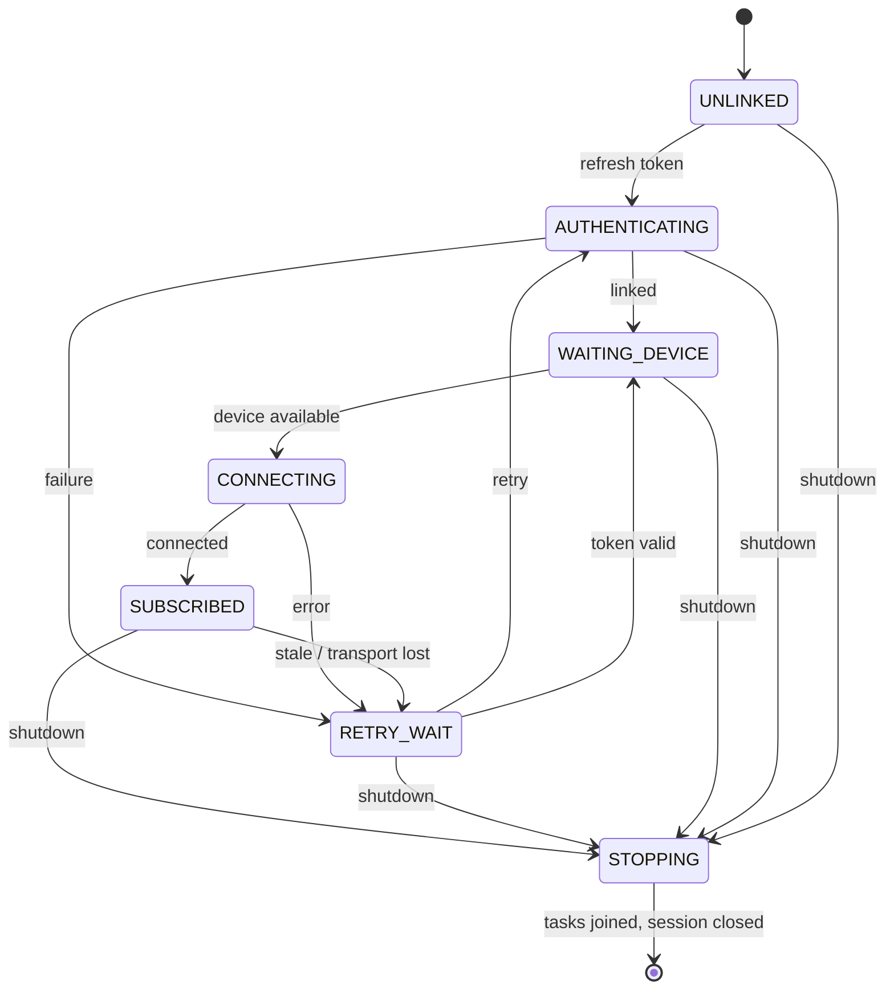

# Implicit state machines — source audit (2026-11-10)

**Scope:** `moyouteam-dz/iSponsorBlockTV` at `main` commit `6a73a2d9e590f0cc7684036ca8fbf26812ceca0a`. This repository currently contains a Python service and Textual configuration UI, **not** an Android application module. These are application-owned stateful processes, not assertions about undocumented internals of third-party protocols.

## Recommendation

**Incremental, regression-first formalization.** Do not rewrite the protocol client or introduce a generic state-machine framework. Preserve JSON schema, CLI flags, defaults, pairing protocol, Docker packaging, and behavior unless a failing regression demonstrates a necessary correction. Characterize each transition with deterministic asyncio tests, then introduce small per-device typed states/immutable snapshots where they eliminate concurrency hazards.

UX: accurate status, recoverable errors, never stale actions. DX: deterministic tests, clear lifecycle ownership, small typed transitions. AX: this map, explicit invariants, test commands and safe modification boundaries.

## Inventory

| ID | Stateful workflow | Source | Implicit states / signals |
| --- | --- | --- | --- |
| SM01 | Application startup & shutdown | `helpers.py:157-224`, `main.py:147-205` | config load → validate → setup/start → running → cancellation → exit |
| SM02 | Configuration draft/save/discard/migration | `helpers.py:41-129`, `setup_wizard.py:144-232,1098-1177` | unchanged ↔ dirty → save/discard; legacy migration |
| SM03 | Manual TV pairing | `setup_wizard.py:234-397,458-506` | empty/invalid → validating → paired/unpaired → add |
| SM04 | Add-device discovery UI | `setup_wizard.py:398-519` | idle → searching → results/empty/error → retry/select/cancel |
| SM05 | SSDP/DIAL discovery transport | `dial_client.py:82-103,214-382` | start → receive → validate → poll/finish → cleanup |
| SM06 | DIAL app launch & pairing fallback | `dial_client.py:129-212` | location verified → query screen → launch → poll code → paired/timeout |
| SM07 | Chromecast discovery | `chromecast_client.py:15-115` | browse → detect → resolve screen → deduplicate → stop |
| SM08 | Cross-source discovery aggregation | `api_helpers.py:27-51,272-289` | await iterator results → deduplicate → finish/cancel |
| SM09 | Channel search/whitelist setup | `setup_wizard.py:522-661`, `api_helpers.py:140-174` | idle → querying → results/empty/error → select/add |
| SM10 | Device authorization | `main.py:27-50` | unlinked → token refresh → linked / retry |
| SM11 | Availability and connection | `main.py:42-75`, `ytlounge.py:310-361` | unavailable → checking → connecting → connected/retry |
| SM12 | Subscription/watchdog | `ytlounge.py:95-152` | subscribing → active → silent over 60s → cancel/reconnect |
| SM13 | Playback event snapshot | `ytlounge.py:21-93,245-249` | stopped/playing/paused; video/time/speed changes |
| SM14 | SponsorBlock skip pipeline | `main.py:77-125`, `api_helpers.py:176-270` | fetch → choose segment → wait → seek/report; cancel/recompute |
| SM15 | Conditional cache | `conditional_ttl_cache.py:31-85` | missing → fetch → expiring/permanent → evicted/expired |
| SM16 | Native-ad mute/skip/volume control | `ytlounge.py:164-218,251-288` | ad starts → mute/skip → ad ends → unmute; command mutex |
| SM17 | Shorts disconnect workaround | `ytlounge.py:231-242` | disconnected → waiting for subtitle event → replay |
| SM18 | Autoplay synchronization | `ytlounge.py:242-244` | device mode change → reapply configured policy |

These are **18 identifiable stateful workflows**, some nested within others. They are not 18 separately implemented formal finite state machines.

## Evidence-backed risks and tests

### P0 — Cancellation and shutdown
- `main.py:27-75` catches `BaseException` around async operations (including cancellation) and nested connection loops do not consistently test `self.cancelled`.
- `main.py:127-141` calls `asyncio.gather` with potentially `None` task references.
- **Test:** cancel while unlinked / offline / connecting / subscribed; assert all loops exit, no task leaks, HTTP session closes exactly once.

### P1 — HTTP errors cached permanently
- `api_helpers.py:197-205` parses JSON *before* checking status and returns `([], True)` on non-200, where `True` means nonexpiring cache.
- **Test:** transient 503 with JSON or HTML → error state remains retryable; subsequent 200 fetch resumes skipping; never treat transport failure as a permanent lack of segments.

### P1 — Pairing validation freshness
- `setup_wizard.py:458-478` increments `pairing_validation_generation` only after valid input; editing valid → invalid leaves the previous generation current.
- **Test:** complete older validation after entering invalid code; no stale device can be added; cancellation and reopening also invalidate results.

### P1 — Channel search can stick
- `setup_wizard.py:614-635`: search button is reenabled only if the result list is truthy.
- **Test:** zero results, API failure and success all return to an actionable idle state.

### P1 — Playback and ad races
- `ytlounge.py:21-93` passes a shared mutable playback state to callbacks; `main.py:77-125` creates per-event tasks and has `if start_next_segment:` (0 is false). Playback speed may be zero during connect.
- `ytlounge.py:164-218` issues independent async mute/unmute/skip commands; serializing individual commands does not guarantee latest desired state wins.
- **Test:** rapid video A→B, pause/resume, seek to 0, speed=0, repeated ad-state events, manual volume change; assert no old-video seek and final mute state matches user intent.

### P1 — Save safety
- `helpers.py:118-129` assigns `config_dict = self.__dict__`, removes keys and then writes JSON; an I/O failure leaves the object mutated.
- **Test:** force a disk write failure, verify config object intact and existing file unchanged; successful save preserves existing JSON keys and values.

### P1 — CLI search argument mismatch
- `config_setup.py:153` invokes `api_helper.search_channels(channel, apikey, web_session)`, but `api_helpers.py:140` accepts only `channel`.
- **Test:** CLI setup channel-search user journey.

### P2 — Discovery and task cleanup
- `api_helpers.py:35-51` cancels iterator tasks without awaiting them or closing the generators; confirm cleanup under cancellation.
- `chromecast_client.py:56-115` passive mode has a finite discovery deadline despite the DIAL passive polling contract; clarify intended feature behavior before modifying it.
- **Test:** retries, duplicate devices, cancellation mid-discovery, transport stop and task/iterator closure.

## Target state graph

Device lifecycle and playback/ad state should remain **orthogonal** to avoid a Cartesian explosion. Explicit models may annotate the existing protocol adapter, not replace upstream transport internals.

## Safe implementation sequence

1. **Characterization tests + CI gate**: add `tests/` for deterministic async transitions and CI Python test job without removing existing Docker/release workflows. Record baseline before changes.
2. **Lifecycle**: handle cancellation explicitly, bound retry waits, filter null task references, join tasks and release owned resources. Keep per-device reconnect semantics.
3. **Pairing/search UX**: invalidate validation for *every* edit and screen exit; reenable search after empty/errors; show accurate UI status.
4. **API/cache**: distinguish empty-success from transient-error; ensure retryable failures cannot persist forever.
5. **Playback/ad**: immutable playback snapshots, monotonic generation tokens, one managed per-device desired mute state; guard old seeks and zero speed.
6. **Configuration**: failure-safe/atomic file persistence and CLI search signature fix. Keep legacy JSON schema.
7. **Discovery**: improve cancellation, generator closing, duplicate suppression with dedicated tests. Address passive-mode semantics only after user-facing contract verified.
8. **Review and release**: review diffs, run full unit suite, compilation, real TV smoke test, Docker build, then propose merge separately.

## Compatibility and verification contract

- Must not modify `main` as part of this audit.
- No network requests in deterministic unit tests. Use fakes and controlled task completion.
- Verify: `python -m compileall -q src`; `python -m pytest -q` once tests/dependencies are installed; targeted async tests; package/Docker build; setup wizard with mocked transport; manual YouTube TV smoke test.
- Do **not** claim runtime fixes without fresh test output. No APK is present in this repository tree; any separately built Android application must be audited in its own branch/repository.
- Never merge/deploy automatically based only on source review.

## Agent handoff rules

Read this file, inspect real source and tests, prefer isolated branch + small PR, add a failing regression before behavior changes, avoid swallowing `asyncio.CancelledError`, do not replace `pyytlounge` internals, preserve configuration schema and current features, and state precisely which tests have actually run.
